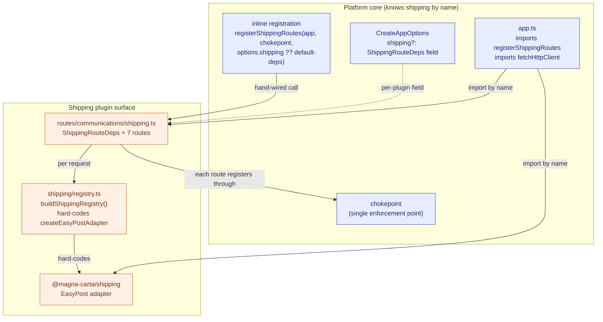
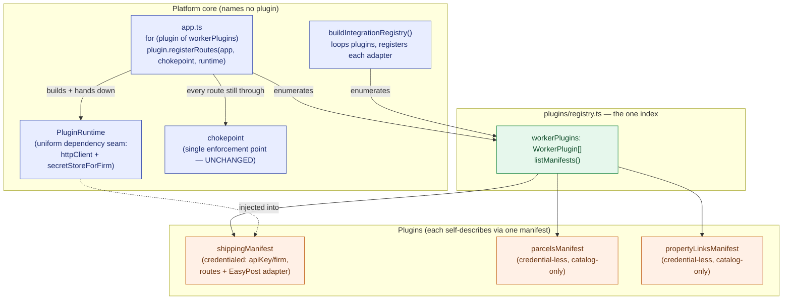
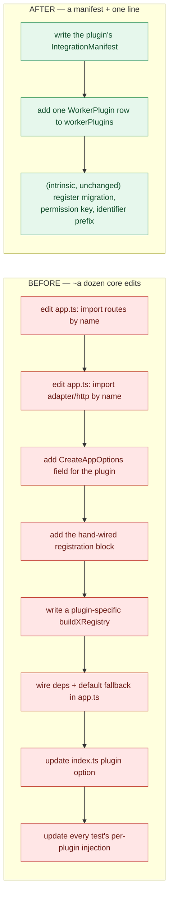
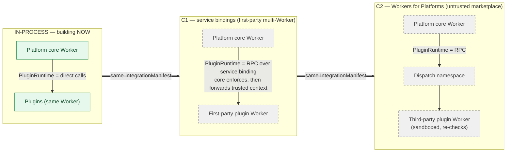

# Integration platform — visual explainer (old wiring vs. the new manifest model)

**Audience:** anyone who wants the shape of the change without reading the code. This sits beside the
[design spec](2026-06-17-integration-platform-foundation-design.md) and its
[implementation plan](2026-06-17-integration-platform-foundation-implementation-plan.md); those two
are the authoritative detail. The diagrams below are grounded in the code as it stands today
(`apps/worker/src/app.ts`, `apps/worker/src/routes/communications/shipping.ts`, `apps/worker/src/shipping/registry.ts`)
and the model the design introduces.

The one-sentence story: **today the platform core _contains_ knowledge of each plugin — it imports
each plugin's routes by name, carries a per-plugin field in its options, and hard-codes the shipping
adapter into a per-request registry. The new model inverts that:** each plugin exports one declarative
`IntegrationManifest`, a single registry index enumerates them, and the worker mounts every plugin in
one loop through the same unchanged enforcement chokepoint. The core stops naming plugins; plugins
self-describe.

---

## 1. Old system — the core knows each plugin by name

Today, adding shipping meant teaching the core about shipping in several places at once. `app.ts`
imports `registerShippingRoutes` and `fetchHttpClient` directly; `CreateAppOptions` carries a
bespoke `shipping?` field; the registration is a hand-written call with an inline default-deps
fallback; and `routes/communications/shipping.ts` reaches back into a shipping-specific `buildShippingRegistry` that
hard-codes `createEasyPostAdapter`. Every one of those is a thread tying the core to this one plugin —
so a second plugin re-creates every thread.



Read the edges as the coupling: the core has **four** distinct references into the one plugin
(named route import, named adapter import, a per-plugin options field, a per-plugin registry helper).
A second plugin would draw the same four edges again — coupling grows with the number of plugins.

---

## 2. New system — the core knows only the registry; plugins self-describe

Each plugin package now exports one pure `IntegrationManifest` (id, category, credential shape,
capability, permission, and — for the worker-coupled ones — its route registration and adapter). A
single worker-side index, `workerPlugins`, is **the only place the core learns a plugin exists**.
`app.ts` mounts every plugin in one loop; `buildIntegrationRegistry` builds the per-request registry
by looping the same list. The chokepoint is untouched — each plugin still registers every route
through it. The core names no plugin.



The inversion: the core now has exactly **one** outbound reference — to `workerPlugins`. Plugins
point _into_ the registry (self-registration); the core does not reach out to name any of them. Adding
the fourth and fifth plugin adds rows to the list, not edges from the core.

---

## 3. Adding a plugin — before vs. after

The clearest measure of the decoupling is what it costs to add one integration. The diagram pairs the
two worlds; the table lists the concrete files.



| Concern               | Before (core edits per plugin)                                               | After                                                                             |
| --------------------- | ---------------------------------------------------------------------------- | --------------------------------------------------------------------------------- |
| Route wiring          | `app.ts` imports `registerShippingRoutes`, hand-writes the registration call | `manifest.registerRoutes` — mounted by the existing loop, no `app.ts` edit        |
| Dependencies          | `CreateAppOptions.shipping?` field + inline default-deps fallback            | one shared `PluginRuntime`, injected to every plugin                              |
| Adapter resolution    | plugin-specific `buildShippingRegistry` hard-coding `createEasyPostAdapter`  | `buildIntegrationRegistry` loops `workerPlugins` and calls each `registerAdapter` |
| Catalog knowledge     | none (no catalog existed)                                                    | one `IntegrationManifest` the registry enumerates                                 |
| Discoverability       | scattered across `app.ts` / `index.ts` / `routes` / `shipping/registry.ts`   | one row in `workerPlugins`                                                        |
| **Migrations**        | core-side                                                                    | **core-side (unchanged — intrinsic)**                                             |
| **Permission key**    | core-side                                                                    | **core-side (unchanged — intrinsic)**                                             |
| **Identifier prefix** | core-side                                                                    | **core-side (unchanged — intrinsic)**                                             |

The bottom three rows are deliberate: migrations, permission keys, and identifier prefixes are
_intrinsic_ shared-resource concerns (one per-firm migration lineage, one access-control registry, one
identifier registry). They cannot be a plugin's private business, so they stay platform-owned in both
worlds. Only the **accidental** coupling — route wiring, dependency plumbing, catalog knowledge —
collapses to a manifest plus one index line.

---

## 4. The C seam — transport progression (future, NOT being built now)

The manifest is deliberately **transport-agnostic**, and `PluginRuntime` is the boundary every plugin
codes against. That makes a future move to isolated plugin Workers a _transport swap beneath the same
contract_ — the manifest never changes. The design records this as the "C seam." **Only the in-process
stage (left) is being built now;** C1 and C2 are documented in an ADR so they are not improvised later,
not scheduled.



The dashed grey stages are not in scope. What stays constant across all three: the manifest contract,
and the fact that `PluginRuntime` is _where_ the transport lives — direct calls in-process, RPC across
a binding in C. Plugin authors never see the difference. The hard problems C must solve (per-firm D1
across Workers, credential custody across the boundary, distributed migration ownership, enforcing the
chokepoint across the boundary, aggregating one OpenAPI contract) are catalogued in the design spec and
its C-seam ADR. The trigger is the first untrusted/third-party plugin — not a date.

---

## 5. Impact summary

**What gets decoupled (accidental coupling removed):**

- **Route wiring** — `app.ts` stops importing any plugin's routes by name; one loop mounts them all.
- **Dependency plumbing** — the per-plugin `CreateAppOptions.shipping?` field and its inline default
  fallback are replaced by one shared `PluginRuntime` injected into every plugin.
- **Catalog / adapter knowledge** — the shipping-specific `buildShippingRegistry` (deleted) becomes
  `buildIntegrationRegistry`, which loops the plugin list; the core no longer hard-codes any adapter.
- **Discoverability** — "what plugins exist" moves from four scattered files to one `workerPlugins` index.

**What stays platform-owned (intrinsic — unchanged on purpose):**

- **Tenancy resolution** — firm-context resolution stays in the core, at every stage.
- **The single chokepoint** — the one tenancy → authn → RBAC → idempotency → rate-limit enforcement
  point; _only route registration_ became data-driven, never enforcement.
- **Migration lineage** — one per-firm lineage applied by the provisioner; a plugin contributes a
  migration to it, it does not own its own.
- **Encryption custody root** — the firm-key / credential custody stays with the platform.

**The security invariant preserved:** there is still exactly **one enforcement point**. Every plugin
route — mounted by the loop instead of by a hand-written call — registers through
`chokepointMiddleware(chokepoint, route)` exactly as before. Making _registration_ data-driven did not
add a path that skips the chokepoint; the fitness test that fails CI if `app.ts` ever re-imports a
plugin route by name guards the decoupling from regressing.

```

```
